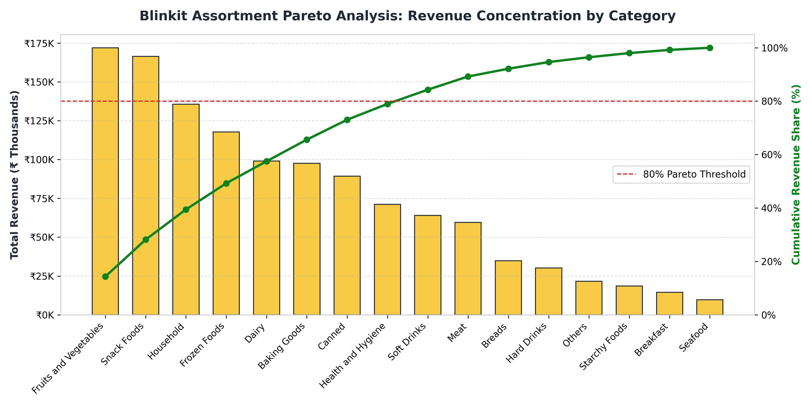
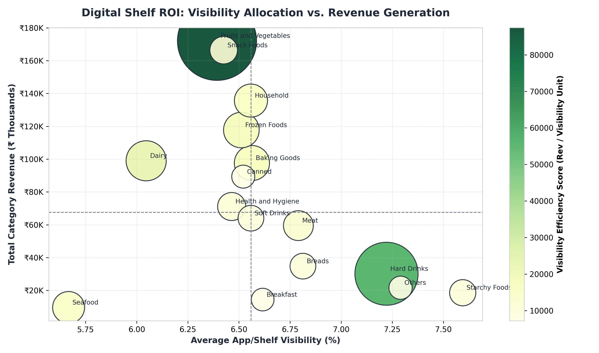
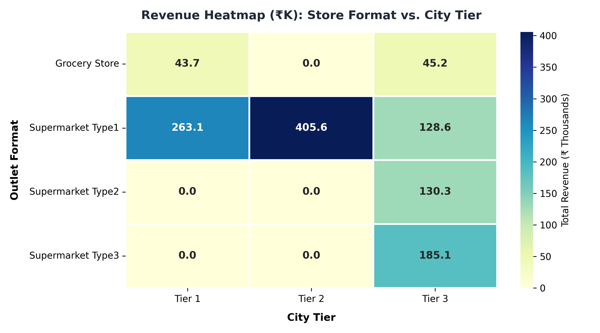

# 🛒 Blinkit Quick-Commerce Retail & Assortment Analytics (SQL + Python)


## 📌 Business Context
Quick-commerce platforms operate on thin margins where **SKU assortment**, **digital shelf visibility**, and **dark-store location strategy** directly dictate profitability. This project builds an end-to-end **SQL & Python analytics pipeline** over **8,500+ retail SKU records** across Blinkit outlets to identify revenue concentration, optimize product visibility allocation, and benchmark store formats across Tier 1, Tier 2, and Tier 3 cities.

---

## 📂 Repository Architecture
```text
blinkit-quick-commerce-analytics/
│
├── assets/                          # Auto-generated 300 DPI executive charts
│   ├── 01_pareto_categories.png
│   ├── 02_visibility_roi_matrix.png
│   └── 03_tier_outlet_heatmap.png
├── data/                            # Raw Kaggle dataset (or auto-generated sample)
├── insights/                        # Exported CSV KPI & analytical summaries
├── sql/
│   ├── 01_schema_and_cleaning.sql   # Data standardization, imputation & analytical VIEW
│   ├── 02_executive_kpis.sql        # Consolidated business health scorecard
│   ├── 03_product_and_pricing.sql   # Pareto 80/20 rule, visibility ROI & MRP tiers
│   └── 04_outlet_performance.sql    # Store matrix, partitioned window rankings
├── run_pipeline.py                  # One-click SQLite ETL + SQL execution + Chart builder
├── requirements.txt
└── README.md
```

---

## 🛠️ Technical Highlights
* **Data Engineering & Cleaning (`01_schema_and_cleaning.sql`):**
  * Standardized inconsistent categorical values (`LF`, `low fat` → `Low Fat`; `reg` → `Regular`).
  * Imputed missing `Outlet_Size` values using domain-aligned mode rules by `Outlet_Type`.
  * Corrected `0.00` `Item_Visibility` anomalies via correlated subqueries using category-level mean visibility.
  * Built a reusable `vw_blinkit_analytics` analytical view with derived `price_tier`, `outlet_age_years`, and `revenue_per_visibility_unit` metrics.
* **Advanced SQL Analytics (`02`–`04`):**
  * **Pareto (80/20) Modeling:** Used `SUM() OVER (ORDER BY ...)` window functions to isolate the core revenue-driving categories.
  * **Shelf-Visibility ROI:** Ranked categories by revenue generated per unit of app/shelf visibility (`RANK() OVER`).
  * **Within-Tier Store Benchmarking:** Used `DENSE_RANK() OVER (PARTITION BY city_tier ...)` and `ROW_NUMBER()` to identify top store formats and category mixes per tier.

---

## 📈 Visual Insights & Recommendations

### 1. Assortment Revenue Concentration (Pareto 80/20 Analysis)

* **Insight:** Top core categories (*Fruits and Vegetables*, *Snack Foods*, *Household*, *Frozen Foods*, *Dairy*) drive the majority of gross merchandise value.
* **Action:** Enforce automated safety-stock thresholds and front-rack dark-store placement for top-decile SKUs to eliminate peak-hour stockouts.

### 2. Digital Shelf Visibility ROI Matrix

* **Insight:** Several high-converting staple categories achieve superior revenue per visibility unit despite moderate screen/shelf exposure.
* **Action:** Reallocate prime app banner real estate from low-efficiency long-tail items to high-converting *Mid-Premium (₹140–₹209)* SKUs to boost Average Order Value (AOV).

### 3. Store Format × City Tier Performance Matrix

* **Insight:** **Tier 3** and **Medium-sized Supermarket Type 1** outlets lead total revenue generation, outperforming smaller grocery formats.
* **Action:** Prioritize dark-store expansion capital toward Medium-format hubs in high-growth Tier 2 and Tier 3 cities.

---

## 🚀 Quick Start (Run in 1 Command)
1. Install dependencies:
   ```bash
   pip install -r requirements.txt
   ```
2. *(Optional)* Replace `data/BlinkIT Grocery Data.csv` with the Kaggle CSV if desired.
3. Run the end-to-end pipeline:
   ```bash
   python run_pipeline.py
   ```

---

## 📄 Resume Bullet Points
* *Engineered an end-to-end SQL & Python retail analytics pipeline on 8,500+ Blinkit SKU records, standardizing dirty categorical data and imputing missing visibility/outlet attributes via SQL views.*
* *Conducted Pareto (80/20) revenue modeling and shelf-visibility ROI analysis using SQL window functions (`SUM() OVER`, `DENSE_RANK()`), automating 300-DPI executive visualizations via Python.*
